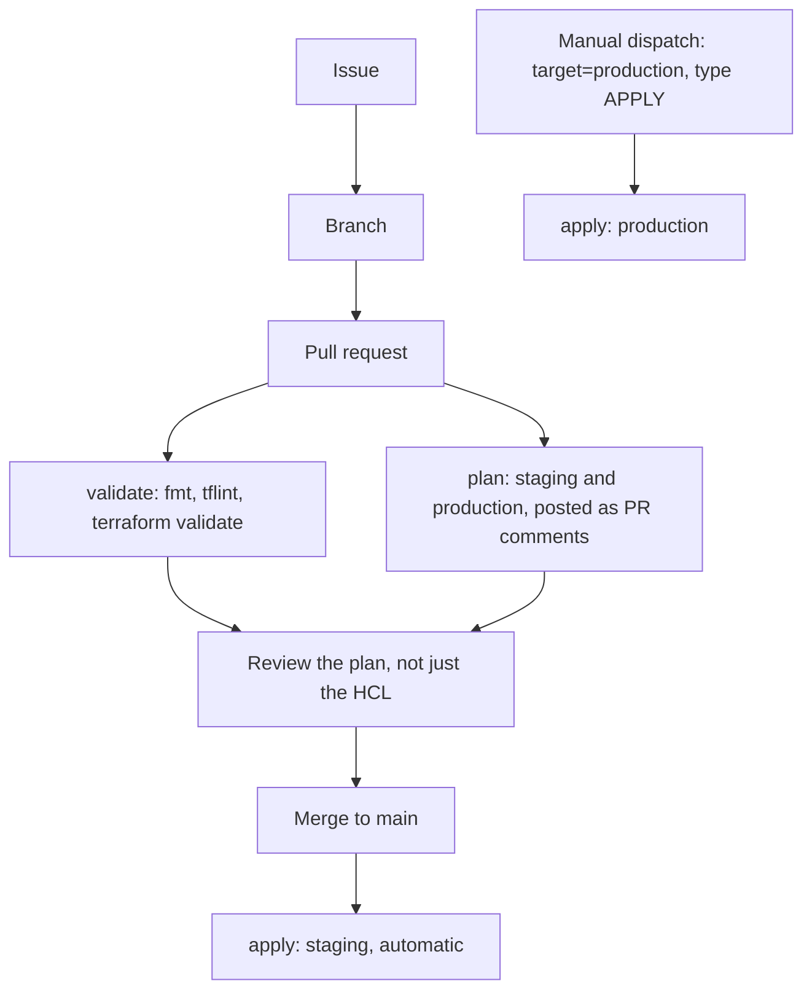

# Discord server as code

A Discord community server — roles, channels, the whole permission matrix,
moderation and the join flow — defined in Terraform and applied by CI through a
reviewed pull request, with a throwaway staging server in front of the real one.

The server itself is for my girlfriend. The reason it looks like this is that I
wanted to stop configuring Discord by hand and start practising the workflow
I'd use on a real engineering team.

---

## Why this exists

Setting up a Discord server "properly" means an afternoon of clicking: a dozen
channels, five roles, and a permission overwrite for every meaningful
combination of the two. Then a month later nobody remembers whether `#rules` is
read-only on purpose, and there is no way to find out except by looking.

The usual answer is to install MEE6, Dyno and Carl-bot and configure those by
hand too, which moves the most behaviour-defining settings in the server into
three web dashboards that cannot be reviewed, diffed or restored.

This repository does the opposite. Everything that defines how the server
behaves is a file, and changing it requires a pull request with a plan attached.

## What it manages

| Area | Resources | Notes |
| --- | --- | --- |
| Server settings | `discord_server_settings` | Verification level, content filter, AFK channel, system channel |
| Roles | `discord_role`, `discord_role_everyone`, `discord_role_positions` | 2 staff roles, 4 opt-in interest roles, and the `@everyone` baseline |
| Structure | `discord_category_channel`, `discord_text_channel`, `discord_voice_channel` | 5 categories, 11 text channels, 3 voice channels |
| Permissions | `discord_channel_permission` | Read-only announcement channels, a staff area hidden from `@everyone` |
| Moderation | `discord_auto_moderation_rule` | 5 rules: Discord's preset wordsets, spam, scam keywords, mention raids, scam text in profiles |
| Join flow | `discord_onboarding`, `discord_welcome_screen` | Self-assign roles without a reaction-role bot |

**No third-party bot is a dependency.** Discord's own AutoMod replaces the
moderation bot, onboarding prompts replace reaction roles, and the welcome
screen replaces the welcome bot — and unlike their third-party equivalents, all
three are in the Discord API and therefore in Terraform. That reasoning is
[ADR 0004](docs/adr/0004-native-discord-features-instead-of-third-party-bots.md).

What is **not** in code — and there is a real list — is written down in
[docs/what-is-not-in-code.md](docs/what-is-not-in-code.md).

## How a change reaches the server



**Production is never reached by a merge.** It runs only from a manual
`workflow_dispatch` where the operator selects `production` and types `APPLY`
into a confirmation box, and the job refuses any ref other than `main`.

That is not the design this started with. The gate was originally a GitHub
Environment with a required reviewer — which turns out to be a public-repo-only
feature on GitHub Free. On a private repo `environment: production` is silently
ignored, so the pipeline would have *looked* gated while a merge applied
straight to the live server. [ADR 0007](docs/adr/0007-manual-trigger-gate-on-a-private-repo.md)
records the discovery, the fix, and what it costs: branch protection and
`CODEOWNERS` have no enforcement on this plan either, so "read the plan before
merging" is now a habit rather than a check.

A plan runs against **production** on every pull request too. Planning is
read-only, and it is how you find out that a change meant for staging would
have deleted a channel in the real server.

## Layout

```
modules/discord-server/      The server, defined once
  main.tf                    Server settings and the default-channel list
  roles.tf                   Roles and the role hierarchy
  channels.tf                Categories and channels
  permissions.tf             Permission overwrites (for_each over channel sets)
  automod.tf                 Moderation policy
  community.tf               Onboarding and welcome screen (Community-gated)
  variables.tf outputs.tf versions.tf

environments/
  staging/                   Throwaway server. Community off.
  production/                The real one. Community on, once bootstrapped.

docs/
  adr/                       Why things are the way they are
  runbooks/                  bootstrap, making-a-change, drift-and-recovery
  what-is-not-in-code.md     The honest boundary

.github/workflows/
  validate.yml               fmt, tflint, module validate. No credentials.
  plan.yml                   Plans both environments, comments on the PR
  apply.yml                  staging, then gated production
```

Both environments call the same module. The only committed differences are the
guild ID, the server name, and two Community flags.

## Decisions

| ADR | Decision |
| --- | --- |
| [0001](docs/adr/0001-manage-the-discord-server-as-code.md) | Manage the server as code at all, and accept drift as the cost |
| [0002](docs/adr/0002-choose-the-smoketurner-discord-provider.md) | Which of five community providers to trust, and pin it exactly |
| [0003](docs/adr/0003-two-guilds-staging-and-production.md) | A throwaway staging guild, because channel deletion is irreversible |
| [0004](docs/adr/0004-native-discord-features-instead-of-third-party-bots.md) | Native Discord features instead of third-party bots |
| [0005](docs/adr/0005-explicit-resources-over-a-channel-factory.md) | Explicit resources over a channel factory; `for_each` only for real repetition |
| [0006](docs/adr/0006-remote-state-in-hcp-terraform.md) | Remote state in HCP Terraform, with the organization kept out of the repo |
| [0007](docs/adr/0007-manual-trigger-gate-on-a-private-repo.md) | Gate production with a manual trigger, because a private repo on Free has no required reviewers |

## Getting started

Start at [docs/runbooks/bootstrap.md](docs/runbooks/bootstrap.md). It is about
an hour, mostly waiting on Discord's UI, and it covers the five things that
genuinely cannot be automated.

Day-to-day work is [docs/runbooks/making-a-change.md](docs/runbooks/making-a-change.md).
When something goes wrong, [docs/runbooks/drift-and-recovery.md](docs/runbooks/drift-and-recovery.md).

## Things worth knowing, found the hard way

Collected here because each one cost real time to establish:

- **There is no official Terraform provider for Discord**, and the most-downloaded
  community one (~147k downloads) is archived and marked "Discontinued". Picking
  by popularity would have picked a dead project. See ADR 0002 for the survey of
  all five candidates as of 2026-11-27.
- **Permissions are not integers in this provider.** They are decimal bitfields
  in a `String`, built with a provider-defined function:
  `provider::discord::permissions(["VIEW_CHANNEL", "SEND_MESSAGES"])`. Provider-defined
  functions need **Terraform 1.8+**.
- **The bot needs Administrator**, not a narrow permission set. Discord refuses
  to let a bot grant a permission through a channel overwrite that the bot does
  not itself hold, unless it has Administrator — and `permissions.tf` grants
  permissions to the Moderator role.
- **The bot's role must be dragged to the top of the role list by hand.** A bot
  cannot create or position a role above its own highest role, and
  `discord_role_positions` puts `Admin` at the top.
- **Onboarding has a hard floor**: at least 7 default channels, of which at
  least 5 must allow `@everyone` to send messages. Delete too many channels and
  the apply fails.
- **Discord maintains the slur and profanity wordsets.** Using
  `trigger_type = "keyword_preset"` with `presets = ["profanity", "sexual_content", "slurs"]`
  means this repository never has to contain a list of slurs. Only the scam
  keyword list is ours, because no preset covers "free nitro" phishing.
- **`AutoMod`'s timeout action only works on `keyword` and `mention_spam` rules.**
  The spam and preset rules alert instead of punishing, because Discord rejects
  the alternative.

## Status

**Validated, not yet applied.** Against Terraform 1.17.2 and
`smoketurner/discord` 0.4.0:

- `terraform validate` passes in all three directories — the module and both
  environment roots.
- `terraform fmt -check -recursive` is clean.
- `tflint --recursive` passes with no findings.
- All 28 permission constants used in `roles.tf` and `permissions.tf` were
  evaluated through `provider::discord::permissions()` and accepted.

One real error surfaced and was fixed: the provider rejects an onboarding
option that grants neither a role nor a channel, which killed a "No thanks"
opt-out in the announcements prompt. With `required = false`, declining is
simply not choosing, so the option was unnecessary.

Still unverified, because it needs a bot token and a live guild:

- No `terraform plan` or `apply` has run against a real server, so nothing here
  has been checked against the Discord API. Enum values such as
  `verification_level = "medium"` and the AutoMod trigger strings are accepted
  by the provider's schema but have not been accepted by Discord.
- Resource counts in the tables above are from reading the configuration.
- `discord_onboarding` and `discord_welcome_screen` are behind
  `enable_community`, so they are off in both environments until
  [bootstrap step 11](docs/runbooks/bootstrap.md).

## Licence

MIT. See [LICENSE](LICENSE).
